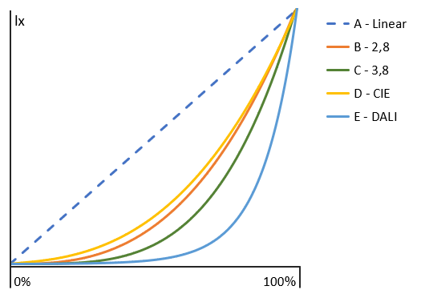
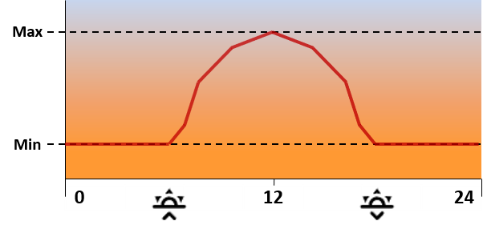
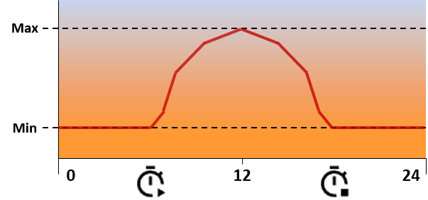

# Applikationsbeschreibung LED-Dimmer

Diese Beschreibung gilt für die ETS-Applikation **OpenKNX: LED Dimmer** ab Version 0.6 und die zugehörige Firmware.

> Die Hilfetexte dieser Datei werden vom OpenKNXproducer in die kontextsensitive Hilfe der ETS übernommen (Ordner `src/Baggages/Help_de`). Die Marker `<!-- DOC ... -->` sind Kommentare und in der gerenderten Ansicht unsichtbar. Nach einer Änderung an dieser Datei die VS-Code-Aufgabe „Hilfetexte erzeugen“ und danach „OpenKNXproducer“ ausführen.

## Inhalte

* [Überblick](#überblick)
* [Inbetriebnahme](#inbetriebnahme)
* [OpenKNX](#openknx)
* [LED: Allgemein](#led-allgemein)
* [LED: Einstellungen](#led-einstellungen)
* [LED: Messungen](#led-messungen)
* [LED: Alarme](#led-alarme)
* [LED: Bedienfeld](#led-bedienfeld)
* [LED: Funktionstests](#led-funktionstests)
* [Kanäle EK, TW und RGB](#kanäle-ek-tw-und-rgb)
* [HCL-Kanäle](#hcl-kanäle)
* [Verhalten bei Neustart und Busspannungsausfall](#verhalten-bei-neustart-und-busspannungsausfall)
* [Kommunikationsobjekte](#kommunikationsobjekte)
* [Diagnose über die Konsole](#diagnose-über-die-konsole)
* [Bekannte Einschränkungen](#bekannte-einschränkungen)

## Überblick

Der OpenKNX LED-Dimmer steuert LED-Streifen und LED-Leuchten mit 24 V Konstantspannung über PWM. Je nach Gerät stehen 6 oder 12 Ausgänge (Ports **A** bis **F** bzw. **A** bis **L**) zur Verfügung. Die Ausgänge werden zu logischen Kanälen zusammengefasst:

| Kanaltyp | Bedeutung | Ports je Kanal |
|---|---|---|
| **EK** – Einzelkanal | eine Farbe, nur Helligkeit | 1 |
| **TW** – Tunable White | Warmweiß und Kaltweiß, Helligkeit und Farbtemperatur | 2 (WW, KW) |
| **RGB** | Farbe über RGB oder HSV | 3 (R, G, B) |

Zusätzlich gibt es drei **HCL-Kanäle** (Human Centric Lighting), die Farbtemperatur und Helligkeit abhängig von der Tageszeit berechnen und an die Dimmkanäle weitergeben.

Weitere Funktionen:

* Messung von Spannung, Strom, Leistung, Energie und optional Temperatur
* Alarmmeldungen bei Über-/Unterspannung, Überstrom und Übertemperatur
* fester Hardware-Überstromschutz, der alle Ausgänge abschaltet
* optionales Bedienfeld mit Display (LED-DK, Hardware V1.2)
* Funktionstaste am Gerät und Funktionstests aus der ETS

### Gerätevarianten

| Gerät | Ausgänge | Funktionstaste | Bedienfeld |
|---|---|---|---|
| LED-DK-6x24V, Hardware V1.0 | 6 | nein | nein |
| LED-DK-6x24V, Hardware V1.2 | 6 | ja | optional |
| LED-DK-12x24V, Hardware V1.0 | 12 | ja | nein |
| LED-DK-12x24V, Hardware V1.2 | 12 | ja | optional |
| LED-APP-6x24V (Applikationsplatine für das Reg1) | 6 | ja | nein |

Jede Hardware-Variante hat eine eigene Firmware. Das Gerät, das in der ETS gewählt ist, muss zur aufgespielten Firmware passen. Es prüft das beim Start; passt es nicht, schaltet es keinen Ausgang (siehe [Gerät](#gerät)).

## Inbetriebnahme

1. Die Produktdatei (`LEDModule.knxprod`) in die ETS importieren und das Gerät in das Projekt einfügen.
2. Unter **LED → Allgemein** das **Gerät** und den **Betriebsmodus** wählen.
3. Die LEDs entsprechend dem angezeigten **Anschlussplan** anschließen.
4. Unter **OpenKNX → Allgemein** bei Bedarf Uhrzeit, Datum und Standort einrichten. Diese werden für die HCL-Kanäle benötigt.
5. Die Kanäle konfigurieren, Gruppenadressen verknüpfen, physikalische Adresse und Applikation programmieren.

Mit **LED → Funktionstests** kannst Du nach dem Programmieren jeden Port einzeln einschalten und so die Verdrahtung prüfen.

## OpenKNX

Die Seiten unter **OpenKNX** (Allgemein, Erweitert, Module, Hilfe) sind bei allen OpenKNX-Geräten gleich. Dort werden u. a. Startverzögerung, „In Betrieb“-Telegramm, Uhrzeit/Datum, Zeitzone, Standort (für die Sonnenstandsberechnung der HCL-Kanäle) und das Diagnoseobjekt eingestellt. Die Beschreibung dazu findest Du in der [Applikationsbeschreibung Common](https://github.com/OpenKNX/OGM-Common/blob/v1/doc/Applikationsbeschreibung-Common.md).

Die Seite **Module** zeigt die Module dieser Applikation mit Version. Das Häkchen „Aktiv“ blendet nur die zugehörigen Seiten in der ETS aus; die Firmware des LED-Dimmers arbeitet unabhängig davon weiter. Das Modul **LED** sollte daher immer aktiv bleiben.

Beim **Konfigurationstransfer** werden Geräteauswahl, Messwiderstand, Temperatursensor und Bedienfeld nicht übertragen: Sie beschreiben die Hardware des einzelnen Geräts.

<!-- DOC HelpContext="PageGeneral" -->
## LED: Allgemein

Auf dieser Seite wird festgelegt, welches Gerät verbaut ist und wie die Ausgänge auf Kanäle aufgeteilt werden. Der Anschlussplan zeigt, welche LED an welchen Port angeschlossen wird.

<!-- DOC HelpContext="DeviceSelect" -->
### Gerät

Hier wählst Du das Gerät aus, das bei Dir verbaut ist, mit seiner Hardware-Version:

* **LED-DK-6x24V V1.0** und **V1.2** – 6-Kanal-Dimmer für den Deckeneinbau
* **LED-DK-12x24V V1.0** und **V1.2** – 12-Kanal-Dimmer für den Deckeneinbau
* **LED-APP-6x24V V0.1** – Applikationsplatine (6 Kanäle) für das Reg1

Die Auswahl bestimmt, welche Betriebsmodi und Anschlusspläne angeboten werden und welche Einstellungen (z. B. Bedienfeld) sichtbar sind.

Das Gerät vergleicht die Auswahl beim Start mit der Hardware, für die seine Firmware gebaut ist. Passt sie nicht oder ist kein Gerät gewählt, legt es keine Kanäle an und schaltet keinen Ausgang, auch nicht über Funktionstaste, Bedienfeld, Konsole oder Funktionstest. Es meldet den Fehler im Log und über das Diagnoseobjekt (`ER HW <Firmware><><ETS>`), auf dem Bedienfeld („Geraet in ETS passt nicht zur Firmware“) und bei der LED-APP mit der Fehler-LED. Abhilfe: das richtige Gerät wählen und neu programmieren.

Beim Aktualisieren einer Applikation vor Version 0.6 ist noch kein Gerät gewählt. Die Einstellungen bleiben erhalten, das Gerät muss aber einmal gewählt werden.

Hinweis: Die Taste [ ▲ ] bzw. [ Prog ] aktiviert den Programmiermodus. Die Taste [ ••• ] bzw. [ Func1 ] löst die Aktionen aus, die Du unter **Einstellungen → Funktionstaste konfigurieren** festlegst.

<!-- DOC HelpContext="OperatingMode" -->
### Betriebsmodus

Der Betriebsmodus legt fest, wie die Ports zu Kanälen zusammengefasst werden:

**6-Kanal-Geräte (Ports A–F):**

* **6x EK:** EK1–EK6 = A–F
* **3x TW:** TW1 = A/B, TW2 = C/D, TW3 = E/F
* **2x TW + 2x EK:** TW1 = A/B, TW2 = C/D, EK1 = E, EK2 = F
* **2x RGB:** RGB1 = A/B/C, RGB2 = D/E/F
* **1x RGB + 1x TW + 1x EK:** RGB1 = A/B/C, TW1 = D/E, EK1 = F
* **1x RGB + 3x EK:** RGB1 = A/B/C, EK1 = D, EK2 = E, EK3 = F

**12-Kanal-Geräte (Ports A–L):**

* **12x EK:** EK1–EK12 = A–L
* **6x TW:** TW1–TW6 = A/B … K/L
* **4x TW + 4x EK:** TW1–TW4 = A/B … G/H, EK1–EK4 = I–L
* **4x RGB:** RGB1–RGB4 = A/B/C … J/K/L
* **2x RGB + 2x TW + 2x EK:** RGB1 = A/B/C, TW1 = D/E, EK1 = F, RGB2 = G/H/I, TW2 = J/K, EK2 = L
* **1x RGB + 4x TW + 1x EK:** RGB1 = A/B/C, TW1 = D/E, EK1 = F, TW2 = G/H, TW3 = I/J, TW4 = K/L

Bei TW ist der erste Port Warmweiß (WW), der zweite Kaltweiß (KW). Bei RGB ist die Reihenfolge Rot, Grün, Blau.

Für jeden Kanal des gewählten Modus erscheint eine eigene Parameterseite. Nicht verwendete Ports bleiben aus. Eine Änderung des Betriebsmodus wird nach dem Programmieren mit einem Neustart wirksam.

<!-- DOCEND -->

<!-- DOC HelpContext="PageConfiguration" -->
## LED: Einstellungen

Geräteweite Einstellungen für alle Kanäle: PWM-Frequenz, Tag/Nacht-Objekt und Funktionstaste.

<!-- DOC HelpContext="PwmFrequenz" -->
### PWM Frequenz

Frequenz, mit der alle Ausgänge gepulst werden. Die Einstellung gilt für alle Ports gemeinsam.

Höhere Frequenzen verringern sichtbares Flackern, z. B. bei Kameraaufnahmen. Niedrigere Frequenzen können bei manchen Netzteilen und Leuchtmitteln Geräusche oder Erwärmung verringern. Der Standardwert von 488 Hz passt für die meisten Installationen.

Der PWM-Baustein kann die Frequenz nur in Stufen einstellen; die tatsächliche Frequenz weicht daher um einige Prozent vom gewählten Wert ab.

<!-- DOC HelpContext="DayNight" -->
### Tag/Nacht Objekt

Legt fest, wie das Kommunikationsobjekt **Tag/Nacht** ausgewertet wird:

* **1=Tag / 0=Nacht**
* **0=Tag / 1=Nacht**

Im Nachtbetrieb verwenden die Kanäle beim Einschalten die Nacht-Einstellungen (siehe **Einschaltverhalten - Nacht**). Kanäle, die bereits eingeschaltet sind, werden beim Wechsel zwischen Tag und Nacht nicht verändert.

Nach einem Neustart ist immer der Tagbetrieb aktiv, bis ein Telegramm auf dem Objekt empfangen wird.

<!-- DOC HelpContext="Func1Action" -->
### Funktionstaste

Die hier gewählten Aktionen löst Du mit der Funktionstaste [ ••• ] bzw. [ Func1 ] am Gerät aus, getrennt für Klick, Doppelklick und langen Klick:

* **Deaktiviert** – keine Aktion
* **Alle Kanäle einschalten** – alle Ports auf 100 %
* **Alle Kanäle ausschalten** – alle Ports aus
* **Alle Kanäle umschalten** – wechselt zwischen ein und aus

Die Funktion ist für eine kurze Systemprüfung der angeschlossenen LEDs gedacht. Sie schaltet die Ports direkt, ohne Dimmkurve und ohne Rampe, und sendet keine Statusmeldungen. Der nächste Befehl an einen Kanal stellt dessen normalen Wert wieder her. Die Info-LED zeigt an, ob die Ports eingeschaltet sind.

Das Gerät LED-DK-6x24V mit Hardware V1.0 hat keine Funktionstaste; bei diesem Gerät blendet die ETS die Einstellungen aus.

<!-- DOCEND -->

<!-- DOC HelpContext="PageMeasurements" -->
## LED: Messungen

Das Gerät misst Spannung, Strom und Leistung der LED-Versorgung und zählt die Energie. Optional wird die Gerätetemperatur gemessen. Die Messwerte werden alle 5 Sekunden erfasst.

<!-- DOC HelpContext="ShuntValue" -->
### Wert des verbauten Messwiderstands

Der Wert muss dem auf der Platine verbauten Messwiderstand (Shunt) entsprechen:

* **0.010 Ohm** – Messbereich bis 8 A (Standard)
* **0.005 Ohm** – Messbereich bis 16 A

Ein falscher Wert verfälscht Strom, Leistung und Energie um den Faktor 2 und verschiebt die Auslöseschwelle des Hardware-Überstromschutzes (siehe **Alarme**).

<!-- DOC HelpContext="SendMeasuredValues" -->
### Messwerte zyklisch senden

Bei **Ja** werden Spannung, Strom, Leistung und Energie zyklisch auf den Bus gesendet. Die Werte werden nicht bei Änderung, sondern nur im eingestellten Intervall gesendet.

* Spannung in V, auf 0,1 V gerundet
* Strom in A, auf 0,01 A gerundet
* Leistung in W, auf 0,01 W gerundet
* Energie in Wh als Zählerwert; der Zähler bleibt über Neustarts und Programmiervorgänge erhalten

<!-- DOC HelpContext="MeasurementInterval" -->
### Messwerte senden alle

Intervall, in dem die Messwerte gesendet werden (Zeit und Zeitbasis). Der erste Wert wird nach Ablauf des ersten Intervalls gesendet. Da die Messung alle 5 Sekunden erfolgt, sind kürzere Intervalle nicht sinnvoll.

<!-- DOC HelpContext="TempSensorPresent" -->
### Temperatursensor verbaut

Gib hier an, ob der optionale Temperatursensor bestückt ist. Bei **Ja** wird die Gerätetemperatur gemessen und zusammen mit den anderen Messwerten gesendet; außerdem kann die Übertemperatur überwacht werden (siehe **Alarme**).

Ist der Sensor eingestellt, aber nicht vorhanden, meldet das Bedienfeld einen Fehler.

<!-- DOCEND -->

<!-- DOC HelpContext="PageAlarm" -->
## LED: Alarme

Hier können Schwellwerte für Über-/Unterspannung, Überstrom und Übertemperatur festgelegt werden. Für jede aktivierte Überwachung erscheint ein Alarmobjekt. Es sendet **1**, sobald der Grenzwert überschritten wird, und **0**, sobald der Wert wieder im zulässigen Bereich liegt. Die Werte werden alle 5 Sekunden geprüft; eine Hysterese gibt es nicht.

Die Alarme dieser Seite melden nur, sie schalten die Ausgänge **nicht** ab. Unabhängig davon schaltet der fest eingestellte Hardware-Überstromschutz bei 6 A alle Ausgänge ab (siehe **Überstrom überwachen**).

<!-- DOC HelpContext="AlarmVoltage" -->
### Spannungsbereich überwachen

Überwacht die Versorgungsspannung der LEDs. Das Objekt **Überspannung** meldet, wenn die Spannung über dem **Grenzwert Überspannung** liegt, das Objekt **Unterspannung**, wenn sie unter dem **Grenzwert Unterspannung** liegt.

Typische Werte für eine 24-V-Versorgung sind 25 V und 23 V.

<!-- DOC HelpContext="AlarmOverCurrent" -->
### Überstrom überwachen

Meldet über das Objekt **Überstrom**, wenn der Gesamtstrom den **Grenzwert Überstrom** übersteigt.

Zusätzlich ist im Gerät ein **Hardware-Überstromschutz** fest eingestellt. Er ist nicht abschaltbar und löst bei 6 A aus (mit Messwiderstand 0,010 Ohm). Er schaltet innerhalb von etwa 0,25 Sekunden **alle Ausgänge ab** und meldet dies über das Diagnoseobjekt. Die Abschaltung bleibt bestehen, bis frühestens 3 Sekunden danach ein Telegramm an einen Kanal empfangen wird. Dann werden die Ausgänge wieder eingeschaltet und der Strom nach 0,4 Sekunden erneut geprüft. Liegt der Überstrom weiter an, wird erneut abgeschaltet.

Ein Grenzwert über 6 A ist daher nicht wirksam.

<!-- DOC HelpContext="AlarmOverTemp" -->
### Übertemperatur überwachen

Meldet über das Objekt **Übertemperatur**, wenn die Gerätetemperatur über dem eingestellten Grenzwert liegt. Diese Überwachung ist nur verfügbar, wenn der Temperatursensor verbaut ist.

Die Ausgänge werden dabei nicht abgeschaltet. Um die LEDs bei Übertemperatur abzuschalten, kann das Alarmobjekt z. B. mit einer Logik verknüpft werden.

<!-- DOCEND -->

<!-- DOC HelpContext="PageFrontPanel" -->
## LED: Bedienfeld

Die Deckeneinbau-Geräte (LED-DK) ab Hardware V1.2 können mit einem Bedienfeld mit Display und vier Tasten ausgestattet werden. Die Applikationsplatine LED-APP hat kein Bedienfeld. Bei LED-DK mit Hardware V1.0 und bei der LED-APP blendet die ETS die Einstellungen dieser Seite aus.

Das Display zeigt Geräteinfo, Status der Bausteine, Messwerte, Energie sowie Uhrzeit und Datum. Mit [ ◀ ] und [ ▶ ] wechselst Du die Anzeige, [ ■ ] führt zurück zur Startseite. Kann ein Baustein nicht erreicht werden, blinkt eine Warnanzeige.

<!-- DOC HelpContext="FrontPanelPresent" -->
### Bedienfeld verbaut

Gib hier an, ob ein Bedienfeld verbaut und angeschlossen ist. Bei **Nein** bleiben Display und Tasten ohne Funktion.

<!-- DOC HelpContext="DisplayTimeOut" -->
### Anzeige ausschalten nach

Nach dieser Zeit ohne Tastendruck schaltet sich die Anzeige aus, um Energie zu sparen. Der nächste Tastendruck schaltet sie wieder ein, ohne eine Aktion auszulösen. Eine Warnanzeige wird nicht ausgeschaltet.

<!-- DOC HelpContext="FrontPanelControl" -->
### Steuerung über das Bedienfeld zulassen

Legt fest, ob über das Bedienfeld geschaltet werden darf:

* **Kanäle schalten:** Auf der Startseite wechselt [ ⬤ ] in die Kanalübersicht. Mit [ ◀ ] und [ ▶ ] wählst Du einen Kanal, mit [ ⬤ ] schaltest Du ihn ein bzw. aus (100 %, ohne Rampe und ohne Statusmeldung). [ ■ ] verlässt die Kanalübersicht.
* **Testmodus:** Auf der Statusseite startet [ ⬤ ] den Testmodus. Dabei wird jeweils ein Port auf 100 % geschaltet und der gemessene Strom angezeigt; mit [ ◀ ] und [ ▶ ] wechselst Du den Port. [ ■ ] beendet den Testmodus, ebenso 5 Minuten ohne Tastendruck.

Bei **Nein** kann die Anzeige weiterhin durchgeblättert werden.

<!-- DOCEND -->

<!-- DOC HelpContext="PageTestCenter" -->
## LED: Funktionstests

Mit den Funktionstests kannst Du aus der ETS heraus einzelne Ports ein- und ausschalten, z. B. um die Verdrahtung zu prüfen. Das Gerät muss dazu programmiert und über eine Busverbindung erreichbar sein.

<!-- DOC HelpContext="FunctionTest" -->
### Kanal und Aktion

Wähle den **Kanal** (Port A bis F bzw. A bis L, siehe Anschlussplan) und die **Aktion** (An oder Aus) und starte den Test mit **Ausführen**.

Der Port wird direkt auf 100 % bzw. 0 % geschaltet, ohne Rampe, ohne Dimmkurve und ohne Statusmeldung. Das funktioniert auch für Ports, die im gewählten Betriebsmodus nicht verwendet werden. Der nächste Befehl an den zugehörigen Kanal stellt dessen normalen Wert wieder her.

Während der Hardware-Überstromschutz ausgelöst hat, wird nicht geschaltet.

<!-- DOCEND -->

## Kanäle EK, TW und RGB

Für jeden Kanal des gewählten Betriebsmodus gibt es eine Seite mit den Grundeinstellungen und die Unterseiten **Dimmprofil**, **Szenen** und – wenn HCL aktiviert ist – **HCL Einstellungen**. Der **Objektname** erscheint im Seitentitel und in den Namen der Kommunikationsobjekte.

<!-- DOC HelpContext="ChannelEK" -->
### Einzelkanal (EK)

Ein EK-Kanal steuert einen Port und regelt nur die Helligkeit. Er kann geschaltet, absolut und relativ gedimmt und über Szenen gesteuert werden.

<!-- DOC HelpContext="ChannelTW" -->
### Tunable White (TW)

Ein TW-Kanal steuert zwei Ports mit warmweißem (WW) und kaltweißem (KW) Leuchtmittel. Helligkeit und Farbtemperatur werden getrennt eingestellt; die Farbtemperatur ergibt sich aus dem Mischungsverhältnis beider Ports. WW und KW werden zeitversetzt angesteuert, damit nie beide gleichzeitig leiten.

<!-- DOC HelpContext="ChannelRGB" -->
### RGB

Ein RGB-Kanal steuert drei Ports (Rot, Grün, Blau). Die Farbe kann als RGB-Wert, als HSV-Wert oder je Farbanteil eingestellt werden. Bei Farbwechseln erreichen alle drei Farben gleichzeitig ihren Zielwert, damit keine falschen Zwischenfarben entstehen.

<!-- DOC HelpContext="ColorTempRange" -->
### Farbtemperatur Warmweiß / Kaltweiß

Gib hier die Farbtemperatur der verwendeten Leuchtmittel an: **Warmweiß** für den WW-Port, **Kaltweiß** für den KW-Port. Die Werte stehen im Datenblatt des LED-Streifens.

Daraus berechnet der Kanal das Mischungsverhältnis. Farbtemperaturen außerhalb dieses Bereichs können nicht dargestellt werden: Kälter als Kaltweiß ergibt nur KW, wärmer als Warmweiß nur WW.

<!-- DOC HelpContext="UseOnValue" -->
### Einschaltverhalten

Legt fest, mit welchem Wert der Kanal eingeschaltet wird (Schalten mit 1 oder Szene mit Aktion „Einschaltwert“):

* **letzter Wert** – der Wert, den der Kanal beim letzten Ausschalten hatte
* **fester Wert** – der darunter eingestellte Einschaltwert

Als letzter Wert gilt der Wert beim Ausschalten über das Schaltobjekt oder eine Szene. Ausschalten durch Dimmen auf 0 % verändert ihn nicht. Er wird nicht dauerhaft gespeichert: Nach einem Neustart gilt 100 % für den Tag und 39 % für die Nacht (TW mit 4000 K, RGB mit einem neutralen Grau).

Wird ein bereits eingeschalteter Kanal erneut eingeschaltet, geht er auf den Einschaltwert zurück.

<!-- DOC HelpContext="UseNightValue" -->
### Einschaltverhalten - Nacht

Wie **Einschaltverhalten**, gilt aber im Nachtbetrieb (siehe **Einstellungen → Tag/Nacht Objekt**). Tag und Nacht haben jeweils einen eigenen letzten Wert. So kann ein Kanal nachts z. B. immer mit geringer Helligkeit einschalten.

<!-- DOC HelpContext="OnBrightness" -->
### Einschaltverhalten - Helligkeit

Helligkeit in Prozent, mit der der Kanal bei **fester Wert** eingeschaltet wird (Tag bzw. Nacht).

<!-- DOC HelpContext="OnColorTemp" -->
### Einschaltverhalten - Farbtemperatur

Farbtemperatur in Kelvin, mit der ein TW-Kanal bei **fester Wert** eingeschaltet wird (Tag bzw. Nacht). Die Farbtemperatur wird beim Einschalten sofort gesetzt, die Helligkeit wird mit der Ein-/Ausschaltgeschwindigkeit gedimmt.

Der Wert sollte zwischen **Farbtemperatur Warmweiß** und **Farbtemperatur Kaltweiß** liegen.

<!-- DOC HelpContext="OnColor" -->
### Einschaltverhalten - Farbe

Farbe, mit der ein RGB-Kanal bei **fester Wert** eingeschaltet wird (Tag bzw. Nacht). Die Helligkeit ist in der Farbe enthalten.

Der Standardwert ist Schwarz (#000000). Bei **fester Wert** muss daher eine Farbe gewählt werden, sonst bleibt der Kanal beim Einschalten dunkel.

<!-- DOC HelpContext="hclActive" -->
### HCL für diesen Kanal aktivieren

Bei **Ja** übernimmt der Kanal Helligkeit und/oder Farbtemperatur von einem HCL-Kanal. Die Einstellungen dazu erscheinen auf der Unterseite **HCL Einstellungen**, die HCL-Kanäle selbst werden unter **HCL** eingerichtet.

<!-- DOCEND -->

### Dimmprofil

<!-- DOC HelpContext="DimCurve" -->
#### Dimmkurve

Die Dimmkurve legt fest, wie der Helligkeitswert in die Ansteuerung des Ports umgerechnet wird:

* **A - Linear** – Wert und Ausgang verhalten sich proportional
* **B - 2,8** – Gamma-Kurve 2,8
* **C - 3,8** – Gamma-Kurve 3,8
* **D - CIE** – nach CIE-Helligkeitsempfinden
* **E - DALI** – logarithmisch wie bei DALI

Das Auge empfindet Helligkeit nicht linear. Für Einzelkanäle empfehlen sich daher die Kurven B bis E, damit das Dimmen gleichmäßig wirkt. Für Tunable White und RGB sollte die Kurve auf **A - Linear** bleiben, da sonst Farbtemperatur bzw. Farbe beim Dimmen verfälscht werden; RGB hat dafür eine eigene Gamma-Korrektur.

Bei den Kurven B und C bleibt der Ausgang bei sehr kleinen Werten (unter etwa 4 % bzw. 9 %) dunkel, obwohl der Kanal als eingeschaltet gemeldet wird.

<!-- DOC Skip="1" -->

<!-- DOC HelpContext="RelativDimTime" -->
#### Relative Dimmgeschwindigkeit

Zeit für das relative Dimmen (heller/dunkler) vom aktuellen Wert bis zum Ende des Bereichs (100 % bzw. aus). Gilt bei TW auch für das relative Dimmen der Farbtemperatur und bei RGB für das relative Dimmen der Farbanteile, der Sättigung und der Helligkeit. Beim relativen Dimmen des Farbtons (RGB) dauert eine volle Umdrehung durch alle Farben diese Zeit.

Relatives Dimmen läuft bis zum Stopp-Telegramm oder bis zum Ende. Die Schrittweite im Telegramm wird nicht ausgewertet; Taster müssen daher „Start/Stopp-Dimmen“ verwenden. Dunkler dimmen endet bei 0 % (aus), heller dimmen schaltet einen ausgeschalteten Kanal ein.

<!-- DOC HelpContext="OnOffTime" -->
#### Ein- und Ausschaltgeschwindigkeit

Dauer jedes Übergangs beim Schalten, beim absoluten Dimmen, bei Szenen und bei HCL-Änderungen. Die Dauer ist unabhängig von der Größe der Änderung: Ein Wechsel von 50 % auf 55 % dauert so lang wie von 0 % auf 100 %.

Die Zeitbasis 1/10 Sekunde erlaubt weiche Übergänge, ohne dass das Schalten träge wirkt (Standard: 5 × 0,1 s).

<!-- DOC HelpContext="GammaCorrection" -->
#### Gamma Korrektur

Gamma-Wert für die Farbdarstellung des RGB-Kanals. Er gleicht die nichtlineare Helligkeitswahrnehmung aus, damit Mischfarben und gedimmte Farben natürlich wirken. Empfohlen ist **2,8**. Mit **1,0** ist die Gamma-Korrektur ausgeschaltet.

Die Gamma-Korrektur wird zusätzlich zur Dimmkurve angewendet. Wird eine nichtlineare Dimmkurve (B bis E) gewählt, sollte die Gamma-Korrektur auf 1,0 stehen.

<!-- DOCEND -->

### Szenen

<!-- DOC HelpContext="Scenes" -->
#### Szenen

Jeder Kanal kann auf bis zu fünf Szenen (A bis E) reagieren. Für jede Szene wird die **Szenennummer** (1 bis 64) und die **Aktion** festgelegt. Empfängt das Szenenobjekt eine passende Szenennummer, führt der Kanal die Aktion mit der Ein-/Ausschaltgeschwindigkeit aus.

Aktionen:

* **nicht aktiv** – die Szene wird ignoriert
* **Einschaltwert (Tag/Nacht)** – wie Einschalten über das Schaltobjekt
* **Helligkeitswert** (EK, TW) – auf die eingetragene Helligkeit in Prozent
* **Farbwert** (RGB) – auf die eingetragene Farbe
* **Farbtemperatur** (TW) – nur die Farbtemperatur ändern, die Helligkeit bleibt
* **Helligkeit und Temperatur** (TW) – Helligkeit und Farbtemperatur setzen
* **ausschalten** – wie Ausschalten über das Schaltobjekt

Das Speichern (Lernen) von Szenen über den Bus wird nicht unterstützt. Ein Lerntelegramm ruft die Szene stattdessen auf.

<!-- DOCEND -->

### HCL Einstellungen

<!-- DOC HelpContext="hclChannel" -->
#### Verwende

Wähle den HCL-Kanal (HCL1 bis HCL3), dessen Werte dieser Kanal übernimmt. Mehrere Kanäle können denselben HCL-Kanal verwenden.

<!-- DOC HelpContext="hclStart" -->
#### HCL anwenden

* **Nur beim Einschalten** – der Kanal schaltet mit den aktuellen HCL-Werten ein. Danach kann er frei gedimmt werden; die HCL-Werte werden erst beim nächsten Einschalten wieder übernommen.
* **Auch wenn eingeschaltet ist** – die HCL-Werte werden zusätzlich jede Minute auf den eingeschalteten Kanal übertragen. Manuelles Dimmen wird dabei bei der nächsten Aktualisierung überschrieben.

Ausgeschaltete Kanäle werden durch HCL nicht eingeschaltet. Außerhalb des Zeitfensters liefert der HCL-Kanal seine Minimalwerte. Solange noch keine HCL-Werte vorliegen (etwa in der ersten Minute nach einem Neustart oder ohne gültige Uhrzeit), schaltet der Kanal mit seinem normalen Einschaltwert ein.

<!-- DOC HelpContext="hclCheck" -->
#### HCL-Werte für diesen Kanal

Legt fest, welche HCL-Werte der Kanal übernimmt:

* **Helligkeit aktivieren** – die Helligkeit des HCL-Kanals
* **Farbtemperatur aktivieren** (TW, RGB) – die Farbtemperatur des HCL-Kanals; ein RGB-Kanal stellt dafür eine passende Weißfarbe ein

Ein EK-Kanal übernimmt nur die Helligkeit.

<!-- DOCEND -->

## HCL-Kanäle

<!-- DOC HelpContext="PageHcl" -->
### HCL – Human Centric Lighting

Ein HCL-Kanal berechnet über den Tag einen Verlauf von Farbtemperatur und Helligkeit, der dem natürlichen Tageslicht nachempfunden ist: morgens und abends warm und gedimmt, zur Mitte des Zeitfensters kühl und hell. Die Werte werden jede Minute neu berechnet, über die Statusobjekte gesendet und an die Kanäle weitergegeben, die diesen HCL-Kanal verwenden.

Für die Berechnung benötigt das Gerät eine gültige Uhrzeit und ein gültiges Datum vom Bus (siehe **OpenKNX → Allgemein**). Ohne gültige Zeit wird nichts berechnet und nichts gesendet.

<!-- DOC HelpContext="HclType" -->
### Ansteuerung über

* **Deaktiviert** – der HCL-Kanal ist aus
* **Sonnen Auf-/Untergang** – das Zeitfenster reicht vom Sonnenaufgang bis zum Sonnenuntergang. Dafür muss unter **OpenKNX → Allgemein** der Standort (Breiten- und Längengrad) eingetragen sein.
* **Feste Zeiten** – das Zeitfenster reicht von der eingestellten Startzeit bis zur Endzeit

Innerhalb des Zeitfensters steigen Farbtemperatur und Helligkeit vom Minimum zum Maximum in der Mitte des Fensters und fallen danach wieder ab. Die Helligkeit nimmt am Nachmittag früher ab als die Farbtemperatur. Außerhalb des Zeitfensters gelten die Minimalwerte.

<!-- DOC Skip="2" -->

<!-- DOC HelpContext="HclOffset" -->
### Verschiebe Sonnenaufgang / Sonnenuntergang

Verschiebt den Beginn bzw. das Ende des Zeitfensters gegenüber dem berechneten Sonnenauf- bzw. -untergang um bis zu 3 Stunden **später** oder **früher**. So kann das HCL-Profil z. B. im Winter früher am Morgen beginnen.

<!-- DOC HelpContext="HclTimes" -->
### Startzeit / Endzeit

Beginn und Ende des Zeitfensters bei **Feste Zeiten** im Format Stunde : Minute. Ein Zeitfenster über Mitternacht ist möglich (Startzeit später als Endzeit). Sind Start- und Endzeit gleich, gelten immer die Minimalwerte.

<!-- DOC HelpContext="HclBrightness" -->
### Helligkeit Min / Max

Bereich der Helligkeit in Prozent. **Min** gilt am Anfang und Ende des Zeitfensters sowie außerhalb, **Max** in der Mitte des Zeitfensters.

<!-- DOC HelpContext="HclColorTemp" -->
### Farbtemperatur Min / Max

Bereich der Farbtemperatur in Kelvin. **Min** (warm) gilt am Anfang und Ende des Zeitfensters sowie außerhalb, **Max** (kühl) in der Mitte des Zeitfensters. Für TW-Kanäle sollte der Bereich innerhalb der Farbtemperaturen der Leuchtmittel liegen.

<!-- DOCEND -->

## Verhalten bei Neustart und Busspannungsausfall

* Nach einem Neustart (Busspannungswiederkehr, Programmieren, Neustart über die Konsole) sind alle Kanäle **aus**. Passt das gewählte Gerät nicht zur Firmware, bleiben sie aus (siehe [Gerät](#gerät)). Ein vorheriger Zustand wird nicht wiederhergestellt, Statusobjekte werden nicht gesendet.
* Nach dem Neustart gilt der Tagbetrieb, bis ein Tag/Nacht-Telegramm empfangen wird.
* HCL-Werte stehen nach etwa einer Minute zur Verfügung, Messwerte nach dem ersten Sendeintervall, Alarme nach etwa 5 Sekunden.
* Bei einem Ausfall der Busspannung werden alle Ausgänge abgeschaltet. Kehrt die Busspannung zurück, ohne dass das Gerät neu startet, nehmen die Kanäle ihren vorherigen Zustand wieder ein.
* Der Energiezähler bleibt über Neustarts und Programmiervorgänge erhalten.

## Kommunikationsobjekte

Die Kommunikationsobjekte der Seiten **OpenKNX** (1 bis 7) sind in der [Applikationsbeschreibung Common](https://github.com/OpenKNX/OGM-Common/blob/v1/doc/Applikationsbeschreibung-Common.md) beschrieben.

Statusobjekte senden, wenn ein Dimmvorgang beendet ist, und nur bei Änderung des Werts (EK-Helligkeit nach jedem Befehl). Sie senden nicht zyklisch und nicht beim Neustart.

### Geräteweite Objekte

| KO | Name | Funktion | DPT | Flags | Hinweis |
|---|---|---|---|---|---|
| 31 | Spannung | Messwert | 14.027 | K L Ü | zyklisch, wenn Messwerte senden = Ja |
| 32 | Spannung Ext | Messwert | 14.027 | K L Ü | nur LED-APP-12x24V, derzeit ohne Funktion |
| 33 | Strom | Messwert | 14.019 | K L Ü | zyklisch |
| 34 | Strom Ext | Messwert | 14.019 | K L Ü | nur LED-APP-12x24V, derzeit ohne Funktion |
| 35 | Wirkleistung | Messwert | 14.056 | K L Ü | zyklisch |
| 36 | Wirkleistung Ext | Messwert | 14.056 | K L Ü | nur LED-APP-12x24V, derzeit ohne Funktion |
| 37 | Wirkleistung (Wh) | Zähler | 13.010 | K L Ü | zyklisch |
| 38 | Wirkleistung (Wh) Ext | Zähler | 13.010 | K L Ü | nur LED-APP-12x24V, derzeit ohne Funktion |
| 39 | Gerätetemperatur | Messwert | 14.068 | K L Ü | nur mit Temperatursensor |
| 40 | Tag/Nacht | Allgemein | 1.011 | K S A | Polarität siehe Einstellungen |
| 45 | Überspannung | Alarm | 1.005 | K L Ü | 1 = Alarm, 0 = Ende |
| 46 | Unterspannung | Alarm | 1.005 | K L Ü | |
| 47 | Übertemperatur | Alarm | 1.005 | K L Ü | nur mit Temperatursensor |
| 48 | Überstrom | Alarm | 1.005 | K L Ü | Meldung des ETS-Grenzwerts |

### Kanalobjekte

Die Objektnummer ergibt sich aus dem Blockanfang des Kanaltyps plus 28 je Kanal plus der relativen Nummer:

| Kanaltyp | Blockanfang | Kanal n |
|---|---|---|
| EK | 57 | 57 + 28 × (n − 1) + relative Nummer |
| TW | 393 | 393 + 28 × (n − 1) + relative Nummer |
| RGB | 561 | 561 + 28 × (n − 1) + relative Nummer |
| HCL | 673 | 673 + 2 × (n − 1) + relative Nummer |

Beispiel: TW2, Schalten = 393 + 28 + 0 = 421.

**EK**

| rel. | Funktion | DPT | Flags |
|---|---|---|---|
| 0 | Schalten | 1.001 | K S A |
| 2 | Dimmen Absolut | 5.001 | K S A |
| 10 | Dimmen Relativ | 3.007 | K S A |
| 16 | Status An/Aus | 1.011 | K L Ü |
| 17 | Status Helligkeit | 5.001 | K L Ü |
| 27 | Szene | 17.001 | K S A |

**TW**

| rel. | Funktion | DPT | Flags |
|---|---|---|---|
| 0 | Schalten | 1.001 | K S A |
| 2 | Dimmen Absolut Helligkeit | 5.001 | K S A |
| 3 | Dimmen Absolut Farbtemperatur (Kelvin) | 7.600 | K S A |
| 10 | Dimmen Relativ Helligkeit | 3.007 | K S A |
| 11 | Dimmen Relativ Farbtemperatur | 3.007 | K S A |
| 16 | Status An/Aus | 1.011 | K L Ü |
| 17 | Status Helligkeit | 5.001 | K L Ü |
| 18 | Status Farbtemperatur (Kelvin) | 7.600 | K L Ü |
| 27 | Szene | 17.001 | K S A |

Relatives Dimmen der Farbtemperatur: heller = kälter (Richtung KW), dunkler = wärmer (Richtung WW).

**RGB**

| rel. | Funktion | DPT | Flags |
|---|---|---|---|
| 0 | Schalten | 1.001 | K S A |
| 2 | Farbeinstellung (RGB) | 232.600 | K S A |
| 3 | Farbeinstellung (HSV) | 232.600 | K S A |
| 4 / 5 / 6 | Dimmen absolut Farbton H / Sättigung S / Helligkeit V | 5.003 / 5.001 / 5.001 | K S A |
| 7 / 8 / 9 | Dimmen absolut Rot / Grün / Blau | 5.001 | K S A |
| 10 / 11 / 12 | Dimmen relativ H / S / V | 3.007 | K S A |
| 13 / 14 / 15 | Dimmen relativ Rot / Grün / Blau | 3.007 | K S A |
| 16 | Status Ein/Aus | 1.011 | K L Ü |
| 17 / 18 | Status Dimmwert RGB / HSV | 232.600 | K L Ü |
| 19 / 20 / 21 | Status Farbton H / Sättigung S / Helligkeit V | 5.003 / 5.001 / 5.001 | K L Ü |
| 22 / 23 / 24 | Status Farbe Rot / Grün / Blau | 5.001 | K L Ü |
| 27 | Szene | 17.001 | K S A |

Beim HSV-Objekt (3 Byte) liegen Farbton, Sättigung und Helligkeit jeweils im Bereich 0 bis 255.

**HCL**

| rel. | Funktion | DPT | Flags |
|---|---|---|---|
| 0 | Status Farbtemperatur (Kelvin) | 7.600 | K L Ü |
| 1 | Status Helligkeit | 5.001 | K L Ü |

Die HCL-Statusobjekte senden jede Minute, solange eine gültige Uhrzeit vorliegt.

## Diagnose über die Konsole

Über die OpenKNX-Konsole (USB) bzw. das Diagnoseobjekt stehen u. a. folgende Befehle zur Verfügung:

| Befehl | Funktion |
|---|---|
| `show con` | Anschlussplan (Kanal → Port) anzeigen |
| `chon <n>` / `choff <n>` / `chval <n> <0-4095>` | Port n (0 = A) direkt setzen (nur Konsole) |
| `test walk` / `test ch <n>` / `test next` / `test prev` / `test stop` | Testmodus: Port für Port auf 100 % mit Strommessung |
| `resetfault` | nach Auslösen des Überstromschutzes wieder einschalten (mit Stromprüfung) |
| `i2c` | I²C-Bus nach Bausteinen durchsuchen |
| `voltage` / `current` / `power` / `energy` / `temp` / `all` | Messwerte anzeigen |
| `ccenergy` | Energiezähler auf 0 setzen |

## Bekannte Einschränkungen

Stand Firmware 0.6:

* **Ext-Messwerte (KO 32, 34, 36, 38):** werden nicht gesendet; für LED-APP-12x24V gibt es noch keine Firmware.
